# Montare Amelie

La scocca di Amelie è fatta di 11 pezzi stampati, tenuti insieme da due soli
tipi di vite. Questa guida dice che cosa stampare, dove va ogni componente e in
che ordine si chiude il dispositivo. I collegamenti elettrici sono nello
[schema](../images/wiring.png).

L'ordine non è arbitrario. Le quattro viti che tengono la torre alla base si
avvitano **dall'interno della base**, e si raggiungono solo finché il fondo è
aperto. Per questo si montano prima il fondo (la Piastra, sul banco) e la torre,
poi si chiude la scocca, e la Piastra si avvita alla base per ultima.

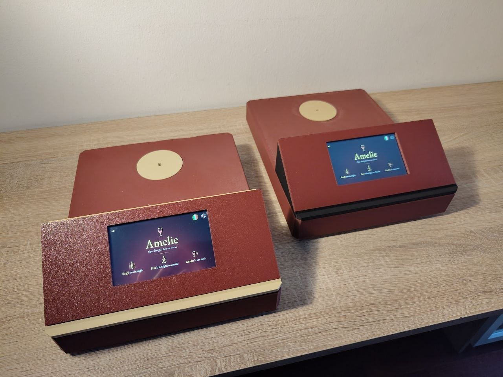

*Due esemplari costruiti dagli stessi file di stampa, con alcuni pezzi in colori diversi.*

## I pezzi da stampare

I file sono in [`hardware/stl/`](../../hardware/stl/).

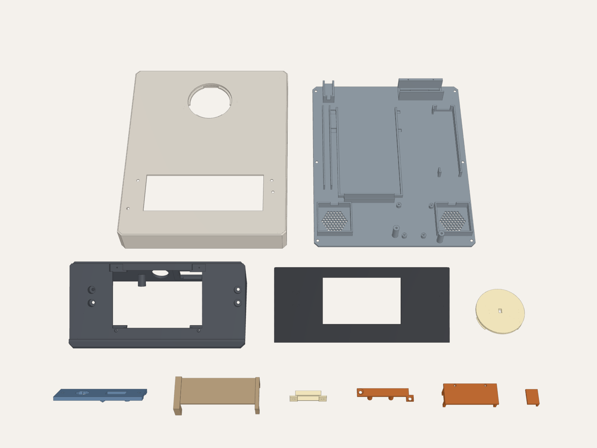

| Pezzo | Che cos'è | Materiale |
|---|---|---|
| `Base.stl` | la scocca: il piano superiore con il foro del disco e la sede della torre, le pareti, la presa di ricarica sul retro | PLA |
| `Piastra.stl` | il fondo removibile: sedi di power bank, hub, UNO Q, casse e interruttore, con le griglie delle casse e la finestra della levetta | PLA |
| `Torre.stl` | il cuneo a 30° che regge lo schermo davanti e l'ottica dietro | PLA |
| `Frontale.stl` | la cornice dello schermo, a filo della rampa | PLA |
| `PannelloOttico.stl` | il pannello dentro la torre: camera e Modulino Pixels | PLA |
| `CerchioLuce.stl` | il disco su cui sta la bottiglia; sotto porta il Modulino Distance | **PETG traslucido** |
| `PlaccaLuce.stl` | la placchetta che chiude la finestra della luce sul retro della torre e la diffonde | **PETG traslucido** |
| `VassoioLuce.stl` | il ponte sopra il power bank, sotto il disco: chiude il fondo della camera di luce | PLA |
| `FermoHub.stl` | il ponticello che tiene l'hub nella sua culla, a scatto | PLA |
| `FermoSwitch.stl` | il coperchio che chiude l'interruttore nella sua sede | PLA |
| `FermoUno.stl` | il ponticello che tiene la UNO Q sui suoi perni | PLA |

La Base si stampa **capovolta**, con il piano superiore sul piatto. Per tutti i
pezzi un riempimento del 15-20 % basta; le viti da legno fanno il filetto nel
materiale, quindi non allargare i fori pilota.

## La viteria

Due tipi di vite in tutto il dispositivo, entrambe a testa svasata.

| Vite | Quante | Dove |
|---|---|---|
| da legno 4 × 16 mm | 4 | Frontale → Torre |
| | 2 | PannelloOttico → Torre |
| | 4 | Torre → Base |
| | 6 | Piastra → Base |
| | 2 | FermoUno → Piastra |
| M2 × 5 mm | 4 | camera → PannelloOttico |
| | 2 | Modulino Distance → CerchioLuce |
| | 2 | PlaccaLuce → Torre, dall'interno |
| M2 × 6 mm | 4 | schermo → Torre, sulle sue alette |
| | 2 | Modulino Pixels → PannelloOttico |
| M2 × 8 mm | 2 | FermoSwitch → Piastra |

In tutto 18 viti da legno 4 × 16 e 16 viti M2. Servono anche 4 piedini adesivi
in gomma (3 mm) e, facoltative, qualche fascetta per i cavi. Le ultime due
rotazioni di ogni vite si danno a mano: nella plastica un avvitatore spana il
filetto.

## Prima di montare: la camera

L'obiettivo M12 della camera esce dalla fabbrica a fuoco lontano. L'etichetta
sta a circa 100 mm: mettilo a fuoco adesso, con la camera collegata a un
computer (è una normale webcam USB) e un'etichetta a 10 cm, ruotando
l'obiettivo nel suo supporto finché le scritte piccole sono nitide. La
regolazione fine si fa a dispositivo montato, con **Debug camera**
([Collaudare](04-collaudo.md)).

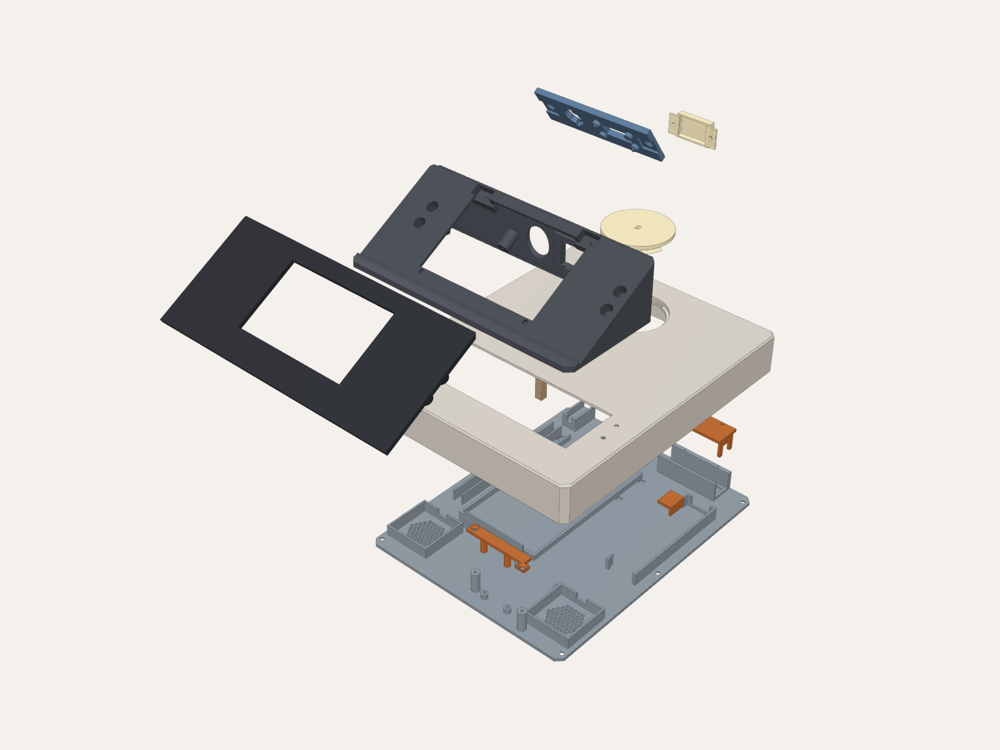

## Fase A: la Piastra

Si lavora sul banco, con la Piastra appoggiata e l'interno verso l'alto. Il
fronte del dispositivo, il lato dello schermo, è il lato delle due casse.

1. **Le casse.** Le due casse vanno nelle gabbie dei due angoli anteriori, con
   la membrana verso il basso, sulle griglie.
2. **Il power bank.** Va nel recinto al centro, **capovolto** e con le porte
   verso il retro: così l'uscita Output 3 finisce a destra, vicino all'hub, e
   la porta USB-C In-Out resta davanti alla presa di ricarica.
3. **L'hub.** Va nella culla sul lato destro, con la fila di porte rivolta
   verso il power bank, il cavo USB-C integrato verso il **retro** e la porta
   HDMI verso il **fronte**. Il FermoHub gli scatta sopra, senza viti.
4. **La UNO Q.** Va fra le due casse, sui quattro perni, con la presa USB-C
   verso il retro e il connettore Qwiic verso il fronte. Il FermoUno scavalca
   il lato del Qwiic e si avvita con due viti 4 × 16.

   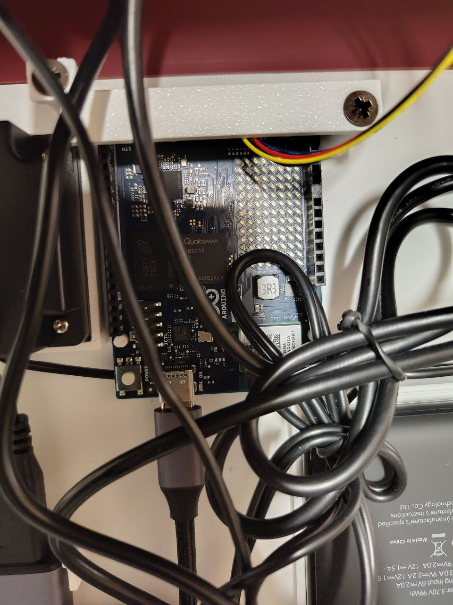

   *La UNO Q tenuta dal FermoUno: in alto il cavo Qwiic, in basso il cavo USB-C.*
5. **L'interruttore.** Il corpo dell'interruttore del cavo di alimentazione va
   disteso nella sua sede nel vano posteriore, con la levetta nella finestra del
   fondo: si aziona da sotto il dispositivo. Il FermoSwitch lo chiude con due
   viti M2 × 8.

   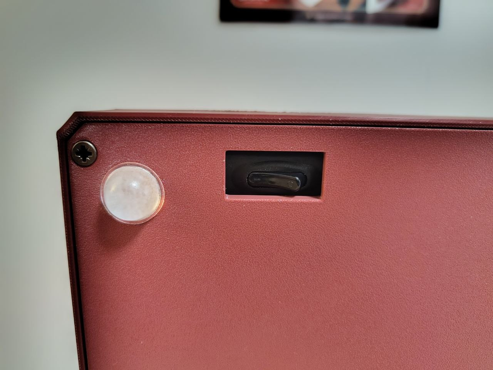

   *Il dispositivo finito visto da sotto: la levetta dell'interruttore nella sua finestra, accanto a un piedino.*
6. **I cavi.**
   - il cavo con l'interruttore: la spina USB-A nella porta **Output 3** del
     power bank, la spina USB-C a 90° nella porta **USB-C PD** dell'hub;
   - il cavo integrato dell'hub: esce dal lato posteriore, gira, corre
     appoggiato sopra l'hub e scende alla USB-C della UNO Q;
   - le casse: la loro spina USB in una porta USB-A dell'hub; il jack audio si
     collega allo schermo alla fase B. Porta al massimo il controllo del volume
     che sta sul loro cavo: a scocca chiusa non lo si raggiunge più, e il volume
     si regola dallo schermo;
   - un cavo Qwiic nel connettore della UNO Q, lungo la parete anteriore: andrà
     al primo dei due Modulino;
   - la prolunga di ricarica: la spina maschio a 90° nella porta **USB-C
     In-Out** del power bank; l'estremità femmina si fissa alla fase C.
7. **Il VassoioLuce.** Si appoggia sulle sue quattro zampe, a ponte sopra il
   power bank.

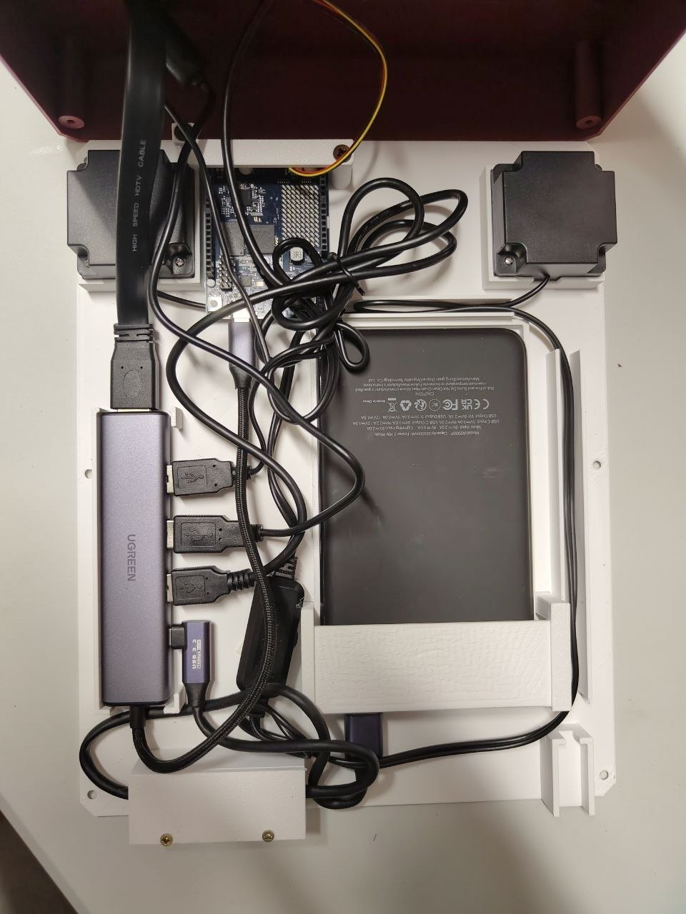

*La Piastra montata, vista dall'alto: le due casse e la UNO Q verso il fronte, il power bank al centro, l'hub accanto e i cavi.*

## Fase B: la torre

La torre si monta capovolta o su un fianco: si lavora dalla pancia aperta.

1. **La PlaccaLuce.** Va nella finestra sul retro della torre, dall'interno,
   con due viti M2 × 5. È la parte da cui esce la luce verso la bottiglia.
2. **Il PannelloOttico.** Prima dei moduli:
   - la camera, **ruotata di 90°**, sulla sua cornice, con quattro viti
     M2 × 5; il supporto dell'obiettivo entra nell'incastro del pannello;
   - il Modulino Pixels sulle sue quattro pastiglie, con due viti M2 × 6 e i
     due perni di centraggio negli altri due fori, i LED verso la finestra;
   - un cavo Qwiic nel Pixels, e il cavo USB della camera.

   Poi il pannello entra nella torre e si avvita con due viti 4 × 16.

   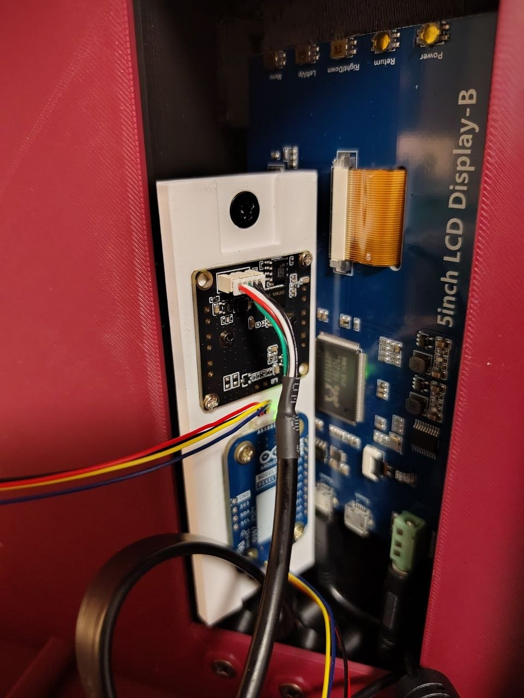

   *Dentro la torre, appoggiata su un fianco: la camera e il Modulino Pixels sul PannelloOttico, ciascuno col suo cavo; dietro, il retro dello schermo.*
3. **Lo schermo.** Va nella tasca della rampa, vetro in fuori e connettori in
   basso, avvitato per le quattro alette con quattro viti M2 × 6. Collega ora
   il cavo HDMI, il cavo da USB-A a micro-USB del touch (quello della
   confezione del power bank) e il jack audio delle casse: dopo non ci si arriva
   più.
4. **Il Frontale.** Chiude la rampa attorno allo schermo, e si avvita
   dall'interno della torre con quattro viti 4 × 16.

## Fase C: la scocca

La Base si capovolge, con il piano superiore sul banco e il fondo aperto verso
l'alto.

1. **Il CerchioLuce.** Sotto il disco si avvita il Modulino Distance con due
   viti M2 × 5, il sensore verso la finestra del disco. Collega il cavo Qwiic.
   Il disco entra nel suo foro dal piano superiore e si blocca con un sesto di
   giro: tre alette gli vanno sotto la mensola. Si toglie allo stesso modo.

   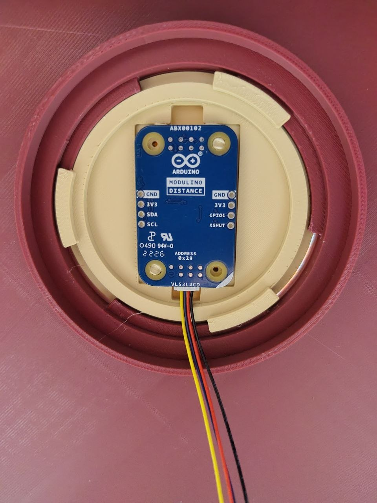

   *Il CerchioLuce visto da sotto, nel suo foro: il Modulino Distance al centro, con il suo cavo Qwiic, e le tre alette sotto la mensola.*
2. **La presa di ricarica.** L'estremità femmina della prolunga entra nella sua
   sede sulla parete posteriore della Base, con l'apertura verso l'esterno.
3. **La torre.** Si appoggia nella sua sede sul piano della Base; i cavi di
   schermo, camera e Pixels scendono attraverso l'apertura. Si avvita con
   quattro viti 4 × 16 **dall'interno della Base, verso l'alto**.

## Fase D: la chiusura

1. **I collegamenti fra la Piastra e il resto.**
   - HDMI: il cavo dello schermo nella porta HDMI dell'hub;
   - USB: il touch dello schermo e la camera nelle due porte USB-A libere
     dell'hub;
   - Qwiic: la UNO Q, il Modulino Distance e il Modulino Pixels in catena;
     l'ordine non conta.

   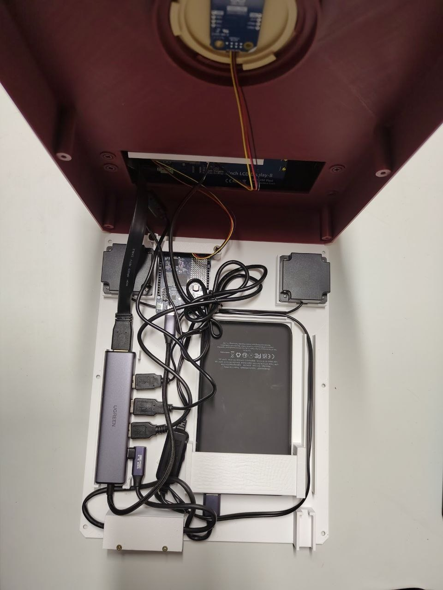

   *Prima di chiudere: la Base capovolta, con il disco, il sensore e il retro dello schermo, sopra la Piastra con tutti i collegamenti fatti.*
2. **Prova prima di chiudere.** Accendi con l'interruttore da sotto e controlla
   la schermata d'attesa, la voce toccando la bandiera attiva, e che posando una
   bottiglia sul disco lo schermo dica «Fammi guardare…». I Modulino si cercano
   all'accensione: se ne manca uno, spegni, controlla il cavo e riaccendi.
3. **La Piastra.** Si cala nella Base, con i cavi raccolti nei vani, e si
   avvita con sei viti 4 × 16 dal fondo.
4. **I piedini.** I quattro piedini adesivi nelle loro sedi sotto la Piastra.

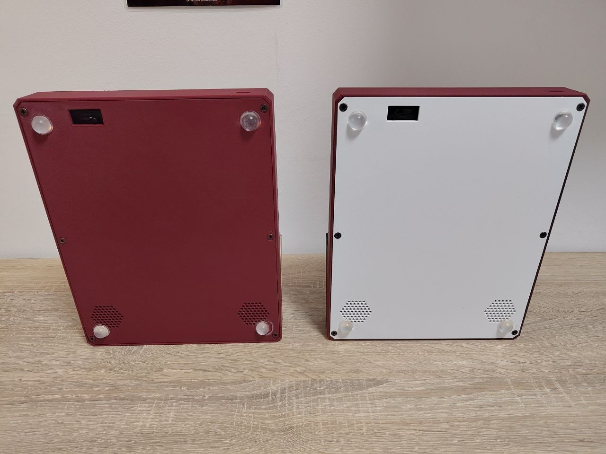

*Il fondo di due esemplari: i quattro piedini, le griglie delle casse e la finestra dell'interruttore.*

## Ricaricare

Il dispositivo si ricarica dalla presa USB-C sul retro con un normale
caricatore USB-C, anche acceso. Dopo la ricarica tocca **Batteria ricaricata**
nelle impostazioni, così la stima riparte da piena ([Usare Amelie](05-uso.md)).

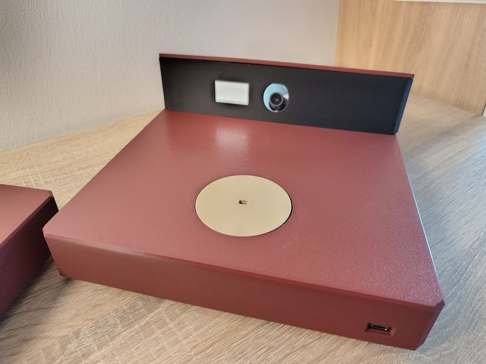

*Il lato del piatto: la camera e la finestra della luce guardano il disco, e la presa di ricarica è in basso sulla parete posteriore.*

## Il passo successivo

[Collaudare Amelie](04-collaudo.md).
